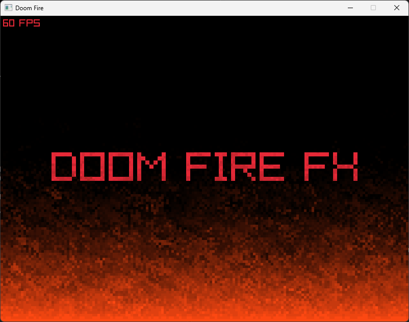

# Doom Fire

Doom Fire é uma pequena demonstração do efeito clássico de fogo em uma janela gráfica, implementada em C++20 com [raylib](https://www.raylib.com/).

O projeto simula a propagação do calor por uma grade de pixels, exibe o título `DOOM FIRE FX` e mostra o FPS atual.

## Captura de tela



## Tecnologias

- C++20
- raylib 5.5
- CMake
- Ninja

## Compilação

```powershell
cmake --preset x64-debug
cmake --build out/build/x64-debug
```

O executável será gerado em `out/build/x64-debug/doom-fire/doom-fire.exe`.
